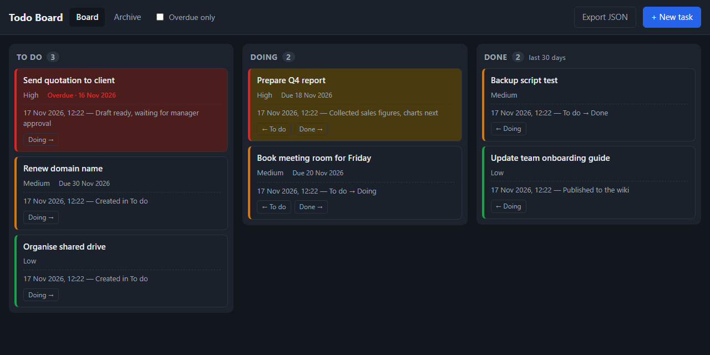
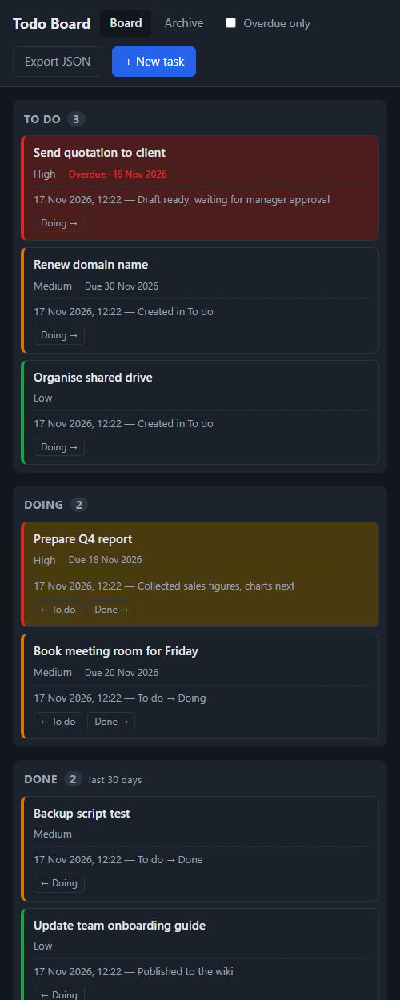

# minitodo

A small, personal Kanban to-do board with an update timeline per task, so you can write down
what you have to do and later see how far each piece of work has got.

Zero npm dependencies: just Node.js and its built-in SQLite. Designed to run on a home or office
server and be reached privately (for example over Tailscale).



## Features

- **Kanban board:** To do, Doing and Done. Drag a card to another column, or use the buttons on the card (works on touch screens).
- **Update timeline:** post progress notes on any task. Each entry is timestamped, and every status change is logged automatically. Notes can be edited within 24 hours of posting; nothing can be deleted from the timeline.
- **Task fields:** title, description, status, due date and priority (High, Medium, Low).
- **Due date highlighting:** overdue cards turn red, cards due within 2 days turn yellow, plus an "Overdue only" filter. There are no push notifications.
- **Archive:** Done tasks older than 30 days leave the board and move to Archive, where you can search them or reopen them.
- **Export:** download everything as JSON.
- **Responsive:** columns stack on small screens. Follows the system light or dark theme.



## Run locally

Requires Node.js 24 or newer (uses the built-in `node:sqlite`).

```bash
npm start        # http://127.0.0.1:3000
npm run dev      # same, restarts when server files change
npm test
```

Data is stored in `data/todo.db`. Configuration is through environment variables:

| Variable  | Default            | Purpose                                   |
|-----------|--------------------|-------------------------------------------|
| `HOST`    | `127.0.0.1`        | Address to listen on                      |
| `PORT`    | `3000`             | Port                                      |
| `DB_PATH` | `data/todo.db`     | SQLite database file                      |

## Security model

There is **no login**. The app is meant for one person and relies on the network to keep others out:
bind it to a private interface only (such as your Tailscale IP) and never expose the port to the internet
or an untrusted LAN. Do not put this on a public address as it stands.

## Deploying

See [DEPLOY.md](DEPLOY.md) for a systemd setup on Rocky Linux 9, including a daily snapshot
backup that is pushed to another machine with a write-only SSH key.

## API

| Method | Path                      | Description                                  |
|--------|---------------------------|----------------------------------------------|
| GET    | `/api/tasks`              | Board tasks (`?view=archive&q=` for archive) |
| POST   | `/api/tasks`              | Create a task                                |
| GET    | `/api/tasks/:id`          | Task with its timeline                       |
| PATCH  | `/api/tasks/:id`          | Update fields or move status                 |
| DELETE | `/api/tasks/:id`          | Delete a task permanently                    |
| POST   | `/api/tasks/:id/updates`  | Add a timeline note                          |
| PATCH  | `/api/updates/:id`        | Edit a note (within 24 hours)                |
| GET    | `/api/export`             | Full JSON export                             |

Write requests must use `Content-Type: application/json`.
